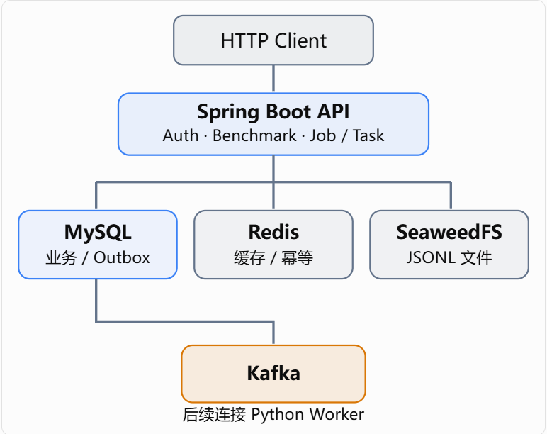

# EvalForge

## 1. 项目简介 (Project Overview)

Evalforge 是一个基于SpringBoot的大模型评测任务管理和异步调度平台，旨在统一管理Benchamrk数据集、版本、模型配置、评测任务。系统通过任务状态机实现评测任务的生命周期管理，结合Redis幂等机制、kafka与Transactional Outbox处理重复任务提交和可靠消息消费，并采用S3兼容对象存储保存Benchmark原始文件。

## 2. 环境与版本 (Environment)

| 组件 | 版本 |
| :--- | :--- |
| MySQL | 8.4.11 |
| JDK | 21.0.12.1 LTS |

## 3. 功能与状态 (Features & Status)

| 功能模块 | 状态 | 说明 |
| :--- | :---: | :--- |
| 用户注册及登录 | ✅ 已实现 | JWT实现登录校验 |
| 用户资源隔离 | ✅ 已实现 | 基于Mysql的owner_id外键校验完成 |
| Benchamrk管理 | ✅ 已实现 | 创建、更新、版本管理、状态管理 |
| JSONL导入 | ✅ 已实现 | 流式导入、解析、校验 |
| Redis缓存及幂等 | ✅ 已实现 | 缓存与数据库幂等记录实现重复请求的幂等校验 |
| EvaluationJob/Task | 🚧 已实现基础流程 | 能够实现一个评测任务的完成的状态流转 |
| SeaweedFS对象存储 | ✅ 已实现 | 源文件上传、下载，跨系统事务的失败补偿机制 |
| kafka Outbox | ✅ 已实现 | 可靠消息发布、消息与数据库事务的原子性解耦 |
| python worker | ⬜ 未实现 | 消费真是评测消息 |

## 4. 系统架构 (System Architecture)



### 任务创建及Outbox发布时序

```text
Client
  │  创建Job
  ▼
Spring Boot
  │  开启事务
  ▼
MySQL   BEGIN   保存EvaluationJob、保存EvaluationTask、保存OutboxEvent   END
  │  COMMIT
  ▼
Outbox Publisher
  │  轮询扫描待发送消息
  ▼
Kafka
  │  ACK
  ▼
Outbox Publisher
  ▼
MySQL   更新OutEvent任务状态
```

OutboxEvent的意义是Mysql无法原子化的提交kafka的消息，将消息的发布意图持久化在数据库中是kafka故障后可以重新发布。

## 5. 主要设计决策 (Key Design Decisions)

### 1. 为什么需要BenchmarkVersion

避免评测过程中数据集被随意修改，确保存在可追溯的历史版本

### 2. 为什么Redis需要结合Mysql

Redis作为缓存降低数据库事务的访问，不能代替数据库的业务的唯一约束

### 3. 为什么Job和Task需要分表

将一份评测任务解耦为用户级别的任务管理以及可执行的单元

### 4. 为什么使用Transactional Outbox

Kafka的消息发布与数据库事务之间无法原子性操作，将消息状态持久化存储在数据库中来实现可靠发布问题，实现数据一致性

### 5. 为什么引入对象存储

文件的元数据与大文件本身进行分离，支持跨服务的文件访问

### 6. 为什么需要失败补偿

Mysql的事务无法回滚SeaweedFS的对象操作，使用失败补偿来解决跨系统的数据一致性问题
